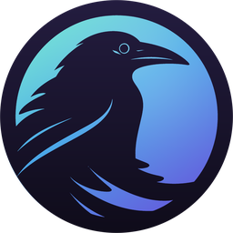
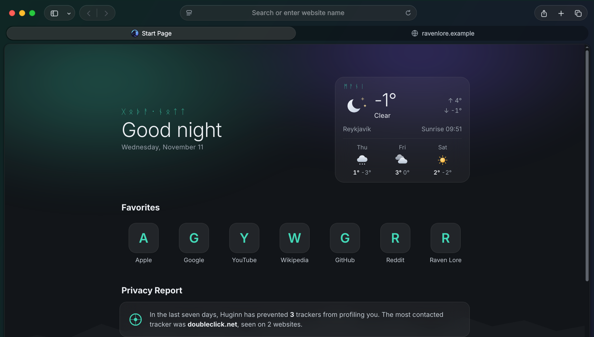
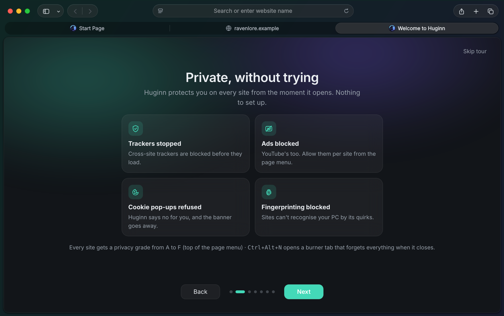
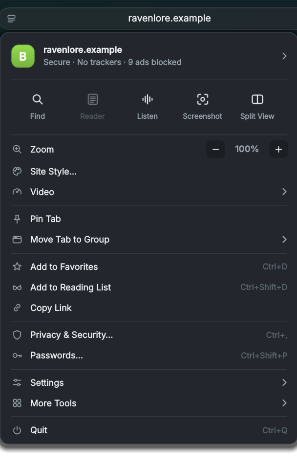

<h1 align="center">Huginn</h1>

<b>A quiet, private, Safari-style browser for Windows.</b> 
Named for Odin's raven of thought, which flies over the world each day and keeps what it sees to itself.

## Install

1. Download the zip from the [latest release](https://github.com/Valkyrii070/huginn/releases/latest) and unzip it.
2. Double-click **Install Huginn.bat** and press **Install**.

That's it. It installs for you only, with no admin rights, to `%LOCALAPPDATA%\Programs\Huginn`, and adds desktop
and Start menu shortcuts plus an entry in **Settings › Apps** for a clean uninstall. Setup takes a few minutes
because it fetches a portable Python and the browser engine (about 250 MB). Needs 64-bit Windows 10 or 11.

The installer has one optional switch, **Build H.264 video support**, off by default. Huginn's standard engine
plays YouTube (VP9/AV1), but Twitch, Reddit, X and many news sites use H.264. With the switch on, Huginn compiles
its own engine with H.264 and AAC in the background after install. That takes a few hours at low priority and
needs about 60 GB free while it works. You can also start it any time later from **Privacy & Security › Video**.

Updates arrive by themselves: copies check this repository's releases once a day and install only updates
signed with the publisher's key.

## What makes it different

**Private, without trying.** Cross-site trackers are blocked before they load. Ads are blocked with the full
EasyList and EasyPrivacy (about 130,000 rules, with no Manifest V3 limits), YouTube's included. Cookie pop-ups are
refused for you. Fingerprinting is blocked, sites are tried over HTTPS first, and DNS lookups are encrypted. Every
site gets a privacy grade from A to F, and **Ctrl+Alt+N** opens a burner tab that forgets everything when it closes.

**The ravens remember.** *Muninn* lets you find a page by what it said: type a few words you remember into the
address bar. *Valhalla* keeps every tab you closed this week, by day. All of it stays on your PC.

**Made to be yours.** Four realms tint the window and the Start Page: Aurora, Bifröst, Muspelheim and Niflheim.
There's light, dark or follow-Windows, and window buttons on the left (Mac) or the right (Windows). The Start Page
greets you in Old Norse if you like, with an optional weather card and slowly rippling aurora curtains.

**And the everyday things done well:** Reader and Read Aloud, Split View, tab groups, pinned tabs, sleeping
tabs, a command bar (**Ctrl+K**), web panels in the sidebar, Game Mode, Focus Hours, a password manager (it can use
iCloud Passwords too), import from Chrome, Edge and Firefox, and a welcome tour the first time it opens.

## Running from source

Huginn is one Python file (`safari_browser.py`) on PySide6 / Qt WebEngine. To run it without installing,
double-click `run.bat`: the first run puts a portable Python and PySide6 inside the folder, and nothing is
installed system-wide. [README.txt](README.txt) is the full manual: every feature, setting and shortcut.

## Privacy

Huginn sends nothing about you anywhere. The only things it fetches by itself are the filter lists (EasyList,
EasyPrivacy), engine security updates when you've built the H.264 engine, updates from this repository, and the
weather if you add a city, in which case only that city's position (rounded to about 1 km) goes to Open-Meteo.

## License

Huginn is free to use, change and share for any **non-commercial** purpose under the
[PolyForm Noncommercial License 1.0.0](LICENSE.md). Selling it or using it commercially
needs the author's permission. The bundled third-party parts keep their own licenses (below).

## Credits

[Qt WebEngine](https://www.qt.io/) / [PySide6](https://doc.qt.io/qtforpython/) (LGPL) ·
[Mozilla Readability](https://github.com/mozilla/readability) (Apache 2.0) ·
[EasyList and EasyPrivacy](https://easylist.to/) ·
weather by [Open-Meteo](https://open-meteo.com/) (CC BY 4.0) ·
spell-check dictionary from [SCOWL](http://wordlist.aspell.net/).
